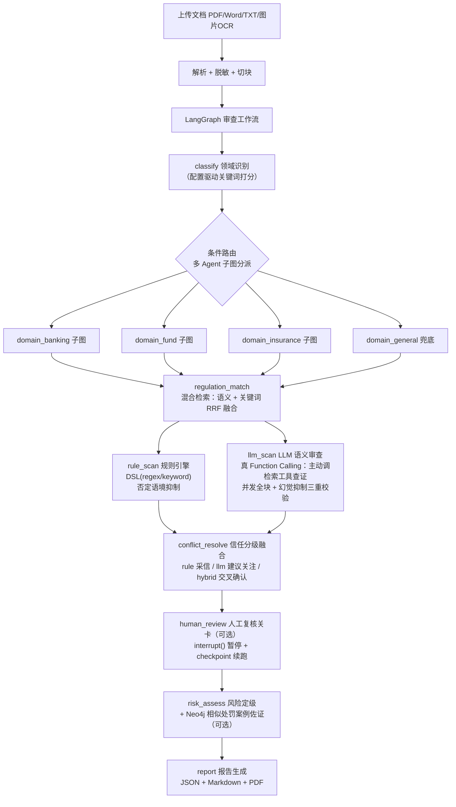
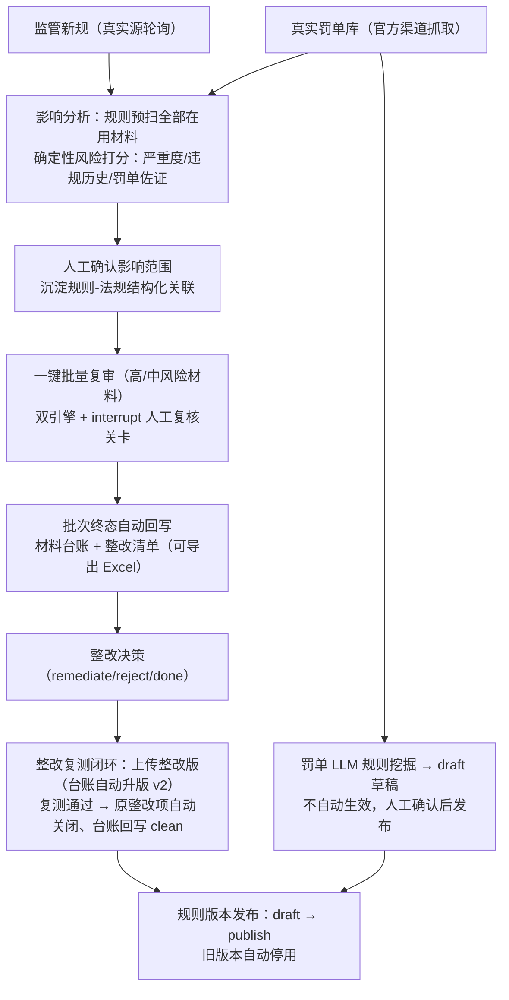

# 金融营销材料智能合规审查与整改管理平台

面向持牌金融机构（银行 / 基金 / 保险）的营销材料合规审查平台：产品海报、宣传册、产品说明书、公众号文章、官网与 App 页面、短视频脚本、销售话术在发布前由系统统一审查。六个审查维度——**禁止性表述 / 限制性表述 / 披露完整性 / 适当性匹配 / 证据核验（引用幻觉拦截）/ 敏感信息（PII 泄露检测）**——输出带**违规定位 / 风险等级 / 法规依据（文号 · 条款 · 发布/生效日期）/ 修改建议 / 历史处罚案例佐证**的结构化审查报告。

能力分三层组织：**核心层**——营销材料合规审查（双引擎 + 信任分级，见架构图）；**管理层**——人工复核 · 整改闭环 · 审查留痕（合规运营闭环）；**智能层**——Agentic RAG · 法规知识库 · 可溯源证据网络 · 规则数据飞轮。

人机协同定位（不是替代合规人员）：AI 负责高频初筛、法规检索与风险解释，合规人员负责最终判断、规则确认与整改审批。结论按证据强度分级呈现——规则命中 = 检测到预设风险模式，LLM 单独命中 = AI 疑似风险（标"建议关注"），进入人工复核并由复核人确认后才形成**已确认违规**的正式结论；每条结论的采纳/纠正全程留痕（审计可溯）。报告支持导出**监管取证证据包**（`GET /tasks/{id}/evidence-pack`：报告 + 结论生命周期 + 操作留痕，zip 内 manifest 记录各文件 SHA256，包自身可验证完整性，用于应对监管现场检查举证）。敏感信息维度为**代码内置检测**（身份证 GB11643 校验位 / 银行卡 Luhn / 手机号边界断言 / 邮箱 / 带标签微信号），不可停用，命中即高置信——身份与联系方式泄露是确定性红线，不走规则生命周期管理。

核心设计是**规则引擎 + LLM 语义引擎双引擎并行**：规则引擎确定性、可解释、零成本，负责字面红线；LLM 引擎（RAG 召回法规条款作上下文）负责换了说法的语义违规。融合策略为**信任分级**——规则命中直接采信，LLM 单独命中标"建议关注"进人工复核，双引擎交叉命中升级为高置信。全流程用 LangGraph 编排：classify 之后按领域**条件路由到 3 个独立领域子图**（banking/fund/insurance，多 Agent 分工），各子图内 `rule_scan ∥ llm_scan` 并行、`interrupt()` 人工复核关卡在共享汇合链；底层 LLM 支持**真 Function Calling**（审查时主动调 `search_regulations` 检索工具查证再判定，配成本护栏）。每层都有优雅降级（LLM 无 Key 跳过 / 模型 fallback / 检索回退 / 队列回退线程池）。

核心审查能力同时封装为**标准 MCP 工具**（`scan_text` / `search_regulations` / `review_text`，stdio 传输），Claude Desktop / 任意 MCP 客户端可直接调用，见 [docs/mcp.md](docs/mcp.md)。处罚案例库为**监管机构官方渠道抓取的真实罚单**（金监总局各监管局信息公开表 + 证监会行政处罚决定书，每条可溯源），见 `scripts/crawl/fetch_penalty_cases.py`。

## 效果与指标口径

> 指标分两套口径，刻意区分"没有回归"与"真的泛化"，详见 [docs/evaluation.md](docs/evaluation.md)；完整基准（引擎对照实验、人机协同漏斗与采纳率口径、复现命令）见 [docs/benchmark.md](docs/benchmark.md)。

| 评估集 | 引擎 | 召回率 | 误报率 | 口径说明 |
|---|---|---|---|---|
| 回归基准集（50 案例 / 139 标注点） | 规则引擎 | 100.0% | 0.0% | **回归门禁**：与规则库有构造对应关系，防规则改动退化，非泛化证明 |
| held-out 变体集（19 案例，保义改写绕开全部字面规则） | 规则引擎单独 | **0.0%** | 0.0% | 规则引擎的泛化边界：字面模式被改写后完全失效 |
| 同上 | 全链路（规则+LLM） | **100.0%** | **0.0%** | LLM 引擎补回全部漏检（检出 100% 来自 llm 来源），合规负样本零误报 |

最后一行对照即双引擎架构的必要性实证：规则引擎认字面，LLM 补语义，披露白名单 prompt 保证补召回不引入误报。复现命令见 docs/evaluation.md。

## 架构



各节点耗时进 `stage_log`（前端任务详情可见），LLM token 用量随报告落盘，可选接入 Langfuse 做 LLM 调用链与成本观测。领域子图与共享汇合链复用同一 `ReviewState`，保证多 Agent 分工下结论仍可追踪、可复现、可审计。

## 合规运营闭环（法规影响中心）

审查报告只是起点，影响中心把"监管变化 → 材料整改 → 规则演进"串成完整运营闭环：



- **确定性影响分析**：受影响规则定位（结构化关联优先 + 二元组分词兜底）+ 材料风险预扫打分，全程无 LLM 参与决策，结果可解释可复核
- **人工复核关卡贯穿闭环**：复审批次与整改复测共用 `interrupt()` 关卡，checkpoint 持久化在 MySQL——API/worker 重启后 `awaiting_review` 任务仍可续跑，崩溃遗留的 `running` 任务由启动钩子自动回收（中断点在人工复核的恢复挂起，其余置 failed 并同步批次计数）
- **违规结论可溯源**：落库时按规则反查规则-法规关联表回填 `regulation_id/article_id`（关联只到法规级时用条款文本重叠启发式定位），人工复核界面每条违规显示《法规名》条款依据
- **风险驾驶舱**：待分析情报 / 待确认评估 / 待整改项 / 台账合规状态一屏总览
- **一键演示**：`python scripts/demo/run_impact_demo.py` 八步全链路（分析→确认→复审→整改→复测闭环→规则发布），带 MySQL/向量库预检与 HIL 自动续跑

## 知识库数据飞轮（P1，2026-08-29）

知识库不再靠纯人工维护，而是一条**官方渠道抓取 → LLM 结构化 → 人工确认 → 规则挖掘 → 对抗验证**的自动化管道，全程可溯源：

```mermaid
flowchart LR
    A["官方源抓取 fetch_regulations.py<br/>gov.cn 检索API / 金监总局规章库JSON / 证监会规章库"] --> B["条款切分<br/>确定性锚点优先 + LLM 兜底"]
    B --> C["人工确认 review_regulations.py<br/>pending 草稿区 → 采纳 → regulations_crawled.json"]
    C --> D["入库导入（幂等 upsert）<br/>→ ChromaDB 向量化 → Neo4j 图谱"]
    D --> E["规则挖掘 mine_rules_from_regulations.py<br/>营销条款 → 规则候选（条款级溯源）"]
    E --> F["三重预校验<br/>regex 预编译 / 引擎冒烟（正例+确定性反例）/ 语义查重"]
    F --> G["draft 规则 → 人工审核 / 证据驱动激活"]
    G --> H["对抗验证 gen_variants.py<br/>LLM 生成保义改写样本 → 逐规则隔离门禁"]
    H -->|不达标自动退回 draft| G
    H -->|通过| I["variant_cases.json 扩充 + 回归门禁"]
```



**当前规模（2026-08-29）**：法规 **48 部 / 809 条款**（其中 20 部为官方渠道全文抓取，含《互联网保险业务监管办法》83 条、《保险经纪人监管规定》108 条全文）、规则 **82 条（75 条激活服役，其中 25 条为挖掘规则）**、真实罚单 **68 条**、对抗评估集 **44 案例 / 89 标注点**。

三层质量关卡：条款切分过条号连续性校验；规则过引擎级冒烟测试（LLM 正例必须命中、否定变体与内置合规语料必须不命中、与库内规则语义查重）；激活前必须通过逐规则隔离门禁（自证召回 100% + 自身零误报）且不破坏回归基准集（gate 口径 0.98/0.02）。不达标者自动退回 draft。

## 检索与评估升级（P2-P5，2026-08-29）

围绕"检索质量与评估自动化"的四个增量，全部带降级链路与离线单测（详见 docs/graphrag.md / docs/agentic-rag.md）：

- **P2 GraphRAG 条款级多跳检索**：`regulation_match` 新增图谱第三路——规则引擎实扫命中的违规模式（节点 id 即规则 id）经条款级 VIOLATES 边多跳展开为"条款级法规依据"，与语义/关键词两路 RRF 融合；挖掘规则的精确条款关联由此直达 LLM 审查上下文
- **P3 Agentic RAG（可选）**：LLM 自评召回条款对文档的覆盖充分性，不充分时生成监管术语化补检查询再检索融合；轮次/查询数/无新增收敛三重护栏，常规开销 = 每任务 1 次评估，`workflow.agentic_retrieval: true` 显式开启
- **P4 LLM-as-a-Judge**：`scripts/evaluate/judge.py` 对 full 引擎输出做语义判分（true_violation / false_positive / wrong_basis）+ 引用可支撑率（确定性幻觉检查）+ 检索相关性（RAGAS 式），弥补 span 口径对 LLM 改写文本的系统性低估；本地 observe-only，不进门禁
- **P5 LLM 精确匹配缓存（可选）**：MySQL 存储的响应缓存（prompt+模型+温度 完全一致才命中，TTL 30 天），任何存储异常按未命中降级；有意不采纳"语义相似度缓存"——合规判定对措辞极度敏感，拿正确性换成本不值得。管理 CLI：`python scripts/llm_cache.py --stats`

## 技术栈

| 层 | 选型 |
|---|---|
| 后端 | FastAPI + SQLAlchemy 2.0 + MySQL 8（JWT + RBAC + 审计日志） |
| Agent 编排 | LangGraph（领域条件路由 → 3 个独立审查子图多 Agent 分工 + 并行分支 reducer 合并 stage_log；`interrupt()` 人工复核关卡 + **自研 MySQL 持久化 checkpointer**（跨进程/跨重启恢复 + 孤儿任务自愈）；底层 LLM 真 Function Calling 工具查证） |
| MCP | 官方 Python SDK（FastMCP，stdio）：规则扫描 / 法规检索 / 双引擎审查三个工具 |
| LLM | 通义千问（DashScope OpenAI 兼容接口），`response_format=json_object` 结构化输出 + 真 Function Calling 工具查证 + 自纠错重试 + 模型 fallback 链 |
| 检索 | ChromaDB + fastembed（`bge-small-zh-v1.5` 本地 ONNX），混合检索 RRF 融合 + 可选 bge-reranker |
| 知识图谱 | Neo4j（可选 profile，法规-条款-违规模式-处罚案例五元关联） |
| 异步任务 | 线程池（默认）/ Celery + Redis（可选，无 worker 自动回退） |
| 前端 | Vue 3 + Vite + TypeScript + Element Plus + Pinia |
| 可观测性 | Langfuse（可选，未配置 Key 时全链路 no-op） |
| 部署 | Docker Compose（默认 / queue / graph 三种 profile） |

## Quick Start

```bash
# 1. 环境变量（至少填 DASHSCOPE_API_KEY 才能启用 LLM 语义审查）
cp .env.example .env

# 2. 起基础设施 + API（默认 profile：mysql + redis + api，MySQL 映射宿主机 3307）
docker compose -f docker/docker-compose.yml up -d

# 3. 初始化数据（法规 / 规则 / 真实处罚案例 / 管理员，然后条款向量化入 ChromaDB）
python scripts/init_data/init_admin.py            # 默认 admin / admin123（RBAC 角色权限 + 管理员，幂等）
python scripts/init_data/import_regulations.py
python scripts/init_data/import_rules.py
python scripts/init_data/import_penalty_cases.py  # 真实罚单（库内累计 68 条，快照 38 条）
python scripts/init_data/import_rules.py --json scripts/init_data/rules_mined.json  # 25 条挖掘规则（与 rules.json 同 schema）
python scripts/init_data/index_articles.py
python scripts/init_data/index_cases.py

# 4. 可选能力
docker compose -f docker/docker-compose.yml --profile graph up -d neo4j   # 知识图谱
python scripts/init_data/import_graph.py --rebuild && python scripts/init_data/import_graph.py --penalty
docker compose -f docker/docker-compose.yml --profile queue up -d worker  # Celery 队列模式
python -m src.mcp_server.server                  # MCP server（stdio，接入见 docs/mcp.md）

# 5. 前端（开发模式）
cd frontend && npm install && npm run dev   # Vite proxy /api/v1 -> localhost:8000

# 仅调前端 UI（后端未就绪时）：起内置 mock API，任意账号密码可登录
cd frontend && node dev-mock.mjs            # 另开终端 npm run dev
# 本机 8000 被其它项目占用时：MOCK_PORT=8001 node dev-mock.mjs
#                              VITE_API_TARGET=http://127.0.0.1:8001 npm run dev
```

- API：`http://localhost:8000`，健康检查 `/api/v1/health`，交互式文档 `/docs`
- 单元测试：`pytest tests/ --basetemp=.pytest-tmp`（数据库不可用的用例自动 skip）
- 评估门禁：`bash scripts/evaluate/gate.sh`（详见 docs/evaluation.md）
- 真实罚单更新：`python scripts/crawl/fetch_penalty_cases.py`（金监总局/证监会官方渠道）
- 发布后内容巡检：`python scripts/poller/patrol_published.py`（与 poll_regulators 同构的定时 CLI，外部计划任务按周期调用，建议 7 天；`--dry-run` 看巡检计划；changed/gone 退出码 1 供计划任务告警）
- LLM-as-a-Judge 评估：`python scripts/evaluate/judge.py --limit 10`（需 API key，observe-only）
- LLM 缓存管理：`python scripts/llm_cache.py --stats`
- 影响中心一键演示：`python scripts/demo/run_impact_demo.py`（八步全链路，需 MySQL/向量库就绪，`--reindex` 可自动重建向量索引）

## 目录结构

```
src/
├── api/                 # FastAPI：14 个路由 + JWT/RBAC 中间件 + 审计日志
├── core/
│   ├── agents/          # LangGraph：state / graph / runtime / 8 个节点（含 human_review）
│   ├── impact/          # 法规影响中心：影响分析（预扫打分）+ 罚单 LLM 规则挖掘
│   ├── rule_engine/     # 规则 DSL 引擎 + regex/keyword matcher + 否定语境抑制
│   ├── llm/             # QWEN 客户端（结构化输出/异步并发/降级链）+ Langfuse 埋点
│   └── report/          # 报告生成：JSON / Markdown / PDF
├── mcp_server/          # MCP server：审查能力封装为 stdio 工具（复用 workflow 节点）
├── services/            # 业务编排：审查/影响中心闭环/法规检索(RRF)/图谱/LLM 缓存/监管动态抓取
├── infrastructure/      # MySQL/Neo4j/ChromaDB/Embedding/Celery + LangGraph MySQL checkpointer
├── parsers/             # txt/docx/pdf/ocr/mineru(可选深解析) + chunker
└── models/              # 14 张业务表 + 2 张 LangGraph checkpoint 表 ORM
scripts/
├── crawl/               # 真实数据爬虫：罚单 + 法规全文（watchlist 驱动）+ 法规规则挖掘
├── demo/                # 影响中心一键演示（八步全链路）+ 固定演示种子
├── evaluate/            # 评估集（回归/变体/挖掘对抗样本）+ 门禁 + 对抗样本生成 + Judge 判分
├── init_data/           # 法规/规则/案例导入 + 向量化 + 图谱构建 + 草稿人工确认 CLI
└── poller/              # 监管动态轮询（人行/金监总局/证监会真实源）
frontend/                # Vue3 前端（任务/知识库/图谱/影响中心/管理 20 个页面）
```

## 质量保障

- **单元 + 集成测试**：344 个用例（规则引擎 / LangGraph 工作流与人工复核 / 领域路由 / LLM 输出校验与工具查证 / 检索融合 / 爬虫解析 / API 层 / MCP stdio 协议级集成 / 影响中心全链路与整改复测闭环 / MySQL checkpointer 原语与跨重启恢复 / 孤儿任务自愈），`pytest tests/ --basetemp=.pytest-tmp`
- **CI（GitHub Actions）**：ruff 静态检查 + 全量测试（MySQL service + 完整种子与向量索引配方，本地已用全新库验证）+ 前端生产构建；另有独立的规则引擎指标门禁 workflow（跌破召回/误报阈值即红）
- **评估门禁**：独立于单测的准确率评估（精确字符级 span 匹配），`--min-recall/--max-fpr` 退出码可接 CI
- **数据卫生**：人工复核统计只计真实人工数据（排除系统自动确认，避免循环论证）；有标注集构建与数据事故的复盘记录（docs/evaluation.md）

## 已知限制（诚实清单）

- 知识库规模仍距生产差 1-2 个数量级：48 部法规 / 809 条款 / 75 条激活规则 / 68 条罚单（数据飞轮已建成，扩规模是重复性劳动）
- 法律类全文仍为节选（保险法/基金法等）：国家法律法规数据库已改版 SPA、检索 API 不可达，待接口恢复后补抓；11 部目标规章官方源未覆盖，记录于 watchlist 待人工兜底
- 挖掘规则激活采用"证据驱动自动激活"（--auto-activate：过对抗门禁即激活），人工可在规则库复核停用；7 条 draft 挖掘规则待人工审核
- Agentic RAG 与 LLM 缓存为显式开启（workflow.agentic_retrieval / workflow.llm_cache），Judge 为本地工具——三者均为成本护栏下的可选增强；judge 判分未经人工金标准校准且与被评模型同源，仅作观测不进门禁
- `VectorStore` 抽象预留了 Milvus 分支但未实现（`NotImplementedError`），当前仅 ChromaDB
- 结构化法条溯源的覆盖度取决于规则-法规关联表：已关联的规则能落到具体条款，历史未关联规则仅有报告级文本引用（hybrid 检索的 related_regulations），启发式兜底只保证"最相关"而非"唯一正确"
- 影响中心的风险打分权重与复测闭环基于固定演示种子（10 材料 / 3 高 3 中 4 低）验证，未经真实合规团队数据校准
- 前端未做生产托管（CI 已验证可构建）；数据库无外键约束（应用层维护一致性）
- 风险定级打分卡权重为经验值，未经真实数据校准
- 采纳率/翻案率的统计出口已建成（review_adoption.py + confirm 判定审计留痕），等待真实使用数据积累——测试期复核数据已按数据卫生约定清理，不用脚本数据冒充人工判断
- MinerU 深解析通道（`parser.mineru_enabled`，默认关）为可选增强：扫描件 PDF 全文解析 + 文字版 PDF 表格块补充（spike：表格 100% 还原、数字召回 96.2%、CPU ~0.2 页/s）；spike 同时发现其会静默漏检封面装饰区文本块，故文字版 PDF 主路永远走 pypdf 文本层、MinerU 只补不替，数字差异记互校日志；MinerU 补入块 page=None（报告定位显示"-"）
- 视觉层交叉篡改检测（R2-3）依赖 VLM 关键数字读出（spike：关键数字 100%/零幻觉）与 OCR/文档数字集比对，OCR 漏读小字数字是残余误报源，产出"疑似篡改"进人工核验而非自动确认
- 勾稽规则引擎（R2-2）v1 覆盖边界：只消费 markdown 表格块（MinerU 通道产物），未开启 MinerU 的文字版 PDF 其表格为乱序碎片、勾稽不生效；表头语义映射为模板层（10 类典型演示表样本 10/10 识别，含货基/保险表正确跳过），LLM 辅助映射为后续增强；转置表（情景矩阵）仅支持跨位置收益率检查，不支持算术勾稽
- 发布后监控（R3-1）v1：巡检对象为台账登记 `publish_url` 的**已授权自有渠道**（不做第三方爬取，微信公众号无官方 API 需人工粘贴兜底）；判定为双层——containment（批准版内容保留率，对网页导航/页脚噪声免疫）+ 关键数字缺失校验（R2-3 互校模式复用，数字被改一票判 changed）；changed 自动创建复审任务（created_by=None 系统发起，批准版文档为 diff 基线）
- 时效性告警（R3-2）：驾驶舱 overview 返回 `stale_materials`（规则停用/法规废止 → rule_regulation_link → 审查结果反向定位的在用材料清单）；`POST /impact/materials/stale/sync` 可将待更新材料写入系统整改清单（复用整改决策/复测/自动关闭链路），依据恢复时条目自动关闭
- 飞轮闭环（R4）已接线：①复核队列支持 `order=priority` 低置信×高风险优先排序（results API）；②judge 新增 `--export-golden`（人工复核结论沉淀金标准集，只取 confirmed_by>0 的真实人工判定）与 `--calibrate`（一致率 <85% 退出码 1 可接 CI）——偿还"judge 未经人工金标准校准"的债，但**依赖真实人工复核数据积累**，演示种子不冒充金标准；③`scripts/evaluate/overturn_review.py` 月度翻案归因（LLM 辅助四分类：规则缺失/检索未召回/提示词误导/解析错误，工单式产出不自动修改，LLM 未配置降级为纯统计）

## 文档

- [docs/evaluation.md](docs/evaluation.md) — 评估方法论、指标口径、门禁与数据卫生记录
- [docs/agents.md](docs/agents.md) — Agent 与组件合约（职责边界 / 输入输出 Schema / 交接与降级 / 指标）
- [docs/benchmark.md](docs/benchmark.md) — 效果基准报告（引擎对照实验 / 复核漏斗 / 复现命令）
- [docs/mcp.md](docs/mcp.md) — MCP Server 接入指南（Claude Desktop / 自研客户端）
