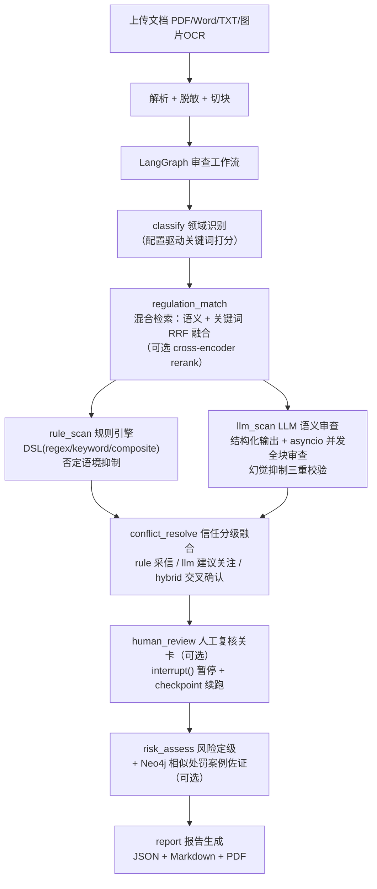

# 金融产品合规智能审查系统

上传一份金融产品营销文档（银行理财 / 基金 / 保险），系统自动审查文案是否踩到监管红线（刚性兑付、保本保收益、虚假宣传、误导销售等），输出带**违规定位 / 风险等级 / 法规依据 / 修改建议 / 历史处罚案例佐证**的结构化审查报告。

核心设计是**规则引擎 + LLM 语义引擎双引擎并行**：规则引擎确定性、可解释、零成本，负责字面红线；LLM 引擎（RAG 召回法规条款作上下文）负责换了说法的语义违规。融合策略为**信任分级**——规则命中直接采信，LLM 单独命中标"建议关注"进人工复核，双引擎交叉命中升级为高置信。全流程用 LangGraph 编排为 8 节点 DAG（含一处 fan-out/fan-in 并行与一个 `interrupt()` 人工复核关卡），每层都有优雅降级（LLM 无 Key 跳过 / 模型 fallback / 检索回退 / 队列回退线程池）。

核心审查能力同时封装为**标准 MCP 工具**（`scan_text` / `search_regulations` / `review_text`，stdio 传输），Claude Desktop / 任意 MCP 客户端可直接调用，见 [docs/mcp.md](docs/mcp.md)。处罚案例库为**监管机构官方渠道抓取的真实罚单**（金监总局各监管局信息公开表 + 证监会行政处罚决定书，每条可溯源），见 `scripts/crawl/fetch_penalty_cases.py`。

## 效果与指标口径

> 指标分两套口径，刻意区分"没有回归"与"真的泛化"，详见 [docs/evaluation.md](docs/evaluation.md)。

| 评估集 | 引擎 | 召回率 | 误报率 | 口径说明 |
|---|---|---|---|---|
| 回归基准集（50 案例 / 139 标注点） | 规则引擎 | 100.0% | 0.0% | **回归门禁**：与规则库有构造对应关系，防规则改动退化，非泛化证明 |
| held-out 变体集（19 案例，保义改写绕开全部字面规则） | 规则引擎单独 | **0.0%** | 0.0% | 规则引擎的泛化边界：字面模式被改写后完全失效 |
| 同上 | 全链路（规则+LLM） | **100.0%** | **0.0%** | LLM 引擎补回全部漏检（检出 100% 来自 llm 来源），合规负样本零误报 |

最后一行对照即双引擎架构的必要性实证：规则引擎认字面，LLM 补语义，披露白名单 prompt 保证补召回不引入误报。复现命令见 docs/evaluation.md。

## 架构



各节点耗时进 `stage_log`（前端任务详情可见），LLM token 用量随报告落盘，可选接入 Langfuse 做 LLM 调用链与成本观测。

## 技术栈

| 层 | 选型 |
|---|---|
| 后端 | FastAPI + SQLAlchemy 2.0 + MySQL 8（JWT + RBAC + 审计日志） |
| Agent 编排 | LangGraph（8 节点 DAG，并行分支 reducer 合并 stage_log；`interrupt()` + InMemorySaver 人工复核关卡） |
| MCP | 官方 Python SDK（FastMCP，stdio）：规则扫描 / 法规检索 / 双引擎审查三个工具 |
| LLM | 通义千问（DashScope OpenAI 兼容接口），`response_format=json_object` 结构化输出 + 自纠错重试 + 模型 fallback 链 |
| 检索 | ChromaDB + fastembed（`bge-small-zh-v1.5` 本地 ONNX），混合检索 RRF 融合 + 可选 bge-reranker |
| 知识图谱 | Neo4j（可选 profile，法规-条款-违规模式-处罚案例五元关联） |
| 异步任务 | 线程池（默认）/ Celery + Redis（可选，无 worker 自动回退） |
| 前端 | Vue 3 + Vite + TypeScript + Element Plus + Pinia |
| 可观测性 | Langfuse（可选，未配置 Key 时全链路 no-op） |
| 部署 | Docker Compose（默认 / queue / graph 三种 profile） |

## Quick Start

```bash
# 1. 环境变量（至少填 DASHSCOPE_API_KEY 才能启用 LLM 语义审查）
cp .env.example .env

# 2. 起基础设施 + API（默认 profile：mysql + redis + api，MySQL 映射宿主机 3307）
docker compose -f docker/docker-compose.yml up -d

# 3. 初始化数据（法规 / 规则 / 真实处罚案例 / 管理员，然后条款向量化入 ChromaDB）
python scripts/init_data/init_admin.py            # admin / admin123
python scripts/init_data/import_regulations.py
python scripts/init_data/import_rules.py
python scripts/init_data/import_penalty_cases.py  # 32 条真实罚单（scripts/init_data/penalty_cases.json）
python scripts/init_data/index_articles.py
python scripts/init_data/index_cases.py

# 4. 可选能力
docker compose -f docker/docker-compose.yml --profile graph up -d neo4j   # 知识图谱
python scripts/init_data/import_graph.py --rebuild && python scripts/init_data/import_graph.py --penalty
docker compose -f docker/docker-compose.yml --profile queue up -d worker  # Celery 队列模式
python -m src.mcp_server.server                  # MCP server（stdio，接入见 docs/mcp.md）

# 5. 前端（开发模式）
cd frontend && npm install && npm run dev   # Vite proxy /api/v1 -> localhost:8000
```

- API：`http://localhost:8000`，健康检查 `/api/v1/health`，交互式文档 `/docs`
- 单元测试：`pytest tests/ --basetemp=.pytest-tmp`（数据库不可用的用例自动 skip）
- 评估门禁：`bash scripts/evaluate/gate.sh`（详见 docs/evaluation.md）
- 真实罚单更新：`python scripts/crawl/fetch_penalty_cases.py`（金监总局/证监会官方渠道）

## 目录结构

```
src/
├── api/                 # FastAPI：12 个路由 + JWT/RBAC 中间件 + 审计日志
├── core/
│   ├── agents/          # LangGraph：state / graph / runtime / 8 个节点（含 human_review）
│   ├── rule_engine/     # 规则 DSL 引擎 + regex/keyword matcher + 否定语境抑制
│   ├── llm/             # QWEN 客户端（结构化输出/异步并发/降级链）+ Langfuse 埋点
│   └── report/          # 报告生成：JSON / Markdown / PDF
├── mcp_server/          # MCP server：审查能力封装为 stdio 工具（复用 workflow 节点）
├── services/            # 业务编排：审查/法规检索(RRF)/图谱/监管动态抓取
├── infrastructure/      # MySQL/Neo4j/ChromaDB/Embedding/Celery
├── parsers/             # txt/docx/pdf/ocr 解析 + chunker
└── models/              # 10 张表 ORM
scripts/
├── crawl/               # 真实处罚数据爬虫（金监总局信息公开表 + 证监会决定书）
├── demo/                # MCP 客户端接入演示
├── evaluate/            # 评估集（含 held-out 变体集）+ 门禁脚本
├── init_data/           # 法规/规则/案例导入 + 向量化 + 图谱构建
└── poller/              # 监管动态轮询（人行/金监总局/证监会真实源）
frontend/                # Vue3 前端（任务/知识库/图谱/管理 18 个页面）
```

## 质量保障

- **单元 + 集成测试**：198 个用例（规则引擎 / LangGraph 工作流与人工复核 / LLM 输出校验 / 检索融合 / 爬虫解析 / API 层 / MCP stdio 协议级集成），`pytest tests/ --basetemp=.pytest-tmp`
- **CI（GitHub Actions）**：ruff 静态检查 + 全量测试（MySQL service + 完整种子与向量索引配方，本地已用全新库验证）+ 前端生产构建；另有独立的规则引擎指标门禁 workflow（跌破召回/误报阈值即红）
- **评估门禁**：独立于单测的准确率评估（精确字符级 span 匹配），`--min-recall/--max-fpr` 退出码可接 CI
- **数据卫生**：人工复核统计只计真实人工数据（排除系统自动确认，避免循环论证）；有标注集构建与数据事故的复盘记录（docs/evaluation.md）

## 已知限制（诚实清单）

- 知识库为演示级：约 28 部法规（节选条款）/ 50 条规则 / 32 条真实处罚案例，距生产差 2-3 个数量级
- `VectorStore` 抽象预留了 Milvus 分支但未实现（`NotImplementedError`），当前仅 ChromaDB
- 人工复核关卡的 InMemorySaver 仅同进程有效，Celery worker 与 API 分进程部署需换持久化 checkpointer（MySQL/Redis 实现，接口已预留）
- 前端未做生产托管（CI 已验证可构建）；数据库无外键约束（应用层维护一致性）
- 风险定级打分卡权重为经验值，未经真实数据校准

## 文档

- [docs/PRD.md](docs/PRD.md) — 产品需求文档（业务背景 / 功能 / API 规范 / 迭代计划）
- [docs/evaluation.md](docs/evaluation.md) — 评估方法论、指标口径、门禁与数据卫生记录
- [docs/mcp.md](docs/mcp.md) — MCP Server 接入指南（Claude Desktop / 自研客户端）
