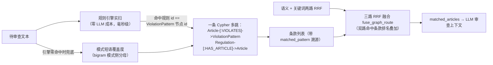

# GraphRAG 条款级多跳检索（P2，2026-08-29）

## 解决什么问题

审查工作流的法规召回原本只有 ChromaDB 语义 + MySQL 关键词两路 RRF（`regulation_match`
节点）。两路都是"文本相似"信号：规则挖掘沉淀的**条款级关联**（哪条规则锚定哪个具体条款）
无法反哺检索，LLM 审查上下文可能缺最该看的条款。

P1 数据飞轮已在图谱里铺好条款级边（`Article -[:VIOLATES {confidence}]-> ViolationPattern`，
来自 `rule_regulation_links` 结构化关联，精度高于按法规全量展开）；P2 把这条边接入检索侧。

## 检索链路



- **引擎实扫优先**：`ViolationPattern` 节点与 Rule 表同源（节点 id = rule.id），规则引擎
  （regex/keyword）对违规措辞的判别远强于字面相似度——命中哪个模式就展开哪个模式的
  条款级溯源。挖掘规则的精确条款关联因此能直达 LLM 上下文，形成飞轮闭环。
- **短语覆盖度兜底**：引擎零命中时退化为模式名/描述的 bigram 覆盖度匹配（分母取模式侧——
  审查文本是整段话术、模式名是短语，按查询侧为分母的相似度恒低于阈值，这正是 old
  `_bigram_score` 不适用于长文本的原因）。
- **防御性上限**：最多 4 个模式 × 每模式 6 条款；导入侧对已有条款级精确关联的规则跳过
  "法规下全部条款"的粗展开（`import_graph.py`），防止历史粗关联边稀释多跳精度。

## 降级链路（全绿无图部署）

| 故障 | 行为 |
|---|---|
| Neo4j 不在线 | `run_cypher` 返回空 → 图谱路空列表，融合退化为原两路 |
| 规则引擎/MySQL 异常 | `_fired_pattern_ids` 吞异常返回空 → 覆盖度兜底 |
| 文本无任何候选模式 | 不发起多跳查询，零开销 |
| 配置关闭 | `workflow.graph_recall: false`（缺省 true）跳过图谱路 |

## 使用与验证

```bash
# 单测（离线 mock，15 例）
pytest tests/unit/test_graphrag.py --basetemp=.pytest-tmp

# 真实链路验证（需 MySQL + Neo4j + 向量库）
python - <<'EOF'
from src.core.agents.nodes.regulation_match import regulation_match
state = regulation_match({"text": "本理财产品保本保息，绝对安全无风险", "domain": "banking"})
for a in state["matched_articles"]:
    print(a.get("source", "hybrid"), a["regulation_name"], a["article_no"])
EOF
```

`source="graph"` 的条款即图谱多跳召回；`matched_pattern` 标注触发它的违规模式，
`pattern_similarity` 为引擎置信度或覆盖度分。

## 边界与后续（诚实清单）

- 图谱路只增强 **LLM 审查上下文的条款召回**，不直接产生违规结论；规则命中本身的
  可解释性仍由规则引擎与 `RuleRegulationLink` 保证。
- 规则引擎的既有误报（如"过往业绩"关键词命中合规披露）会连带召回该规则的关联条款——
  属于上下文噪声而非结论错误，治理依赖 reflow_labels 的真实复核回流。
- 尚未做：违规模式节点的向量索引（语义召回模式而非引擎/字面匹配）、社区摘要式的
  全局 GraphRAG 问答。进 P4/P5 视需要排期。
