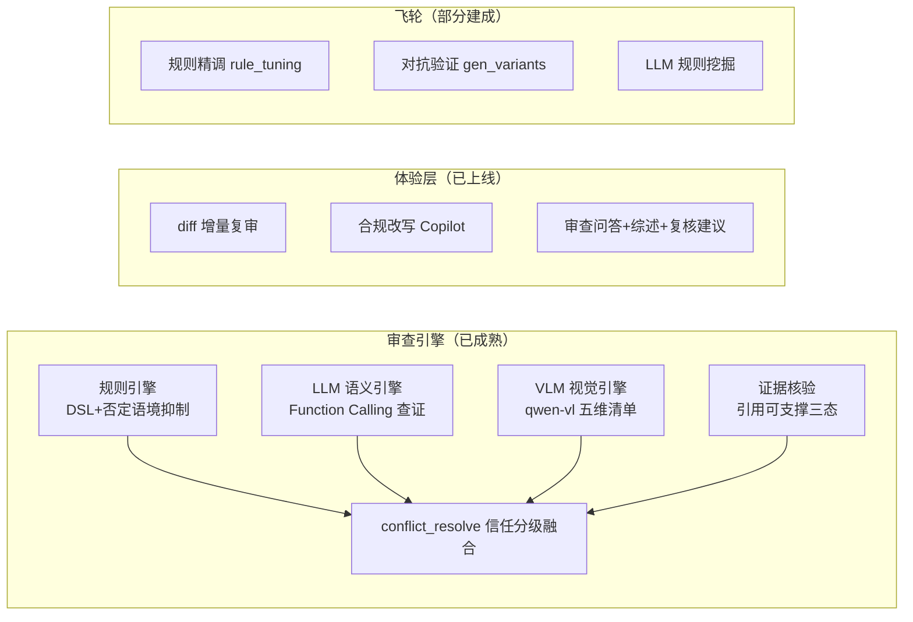
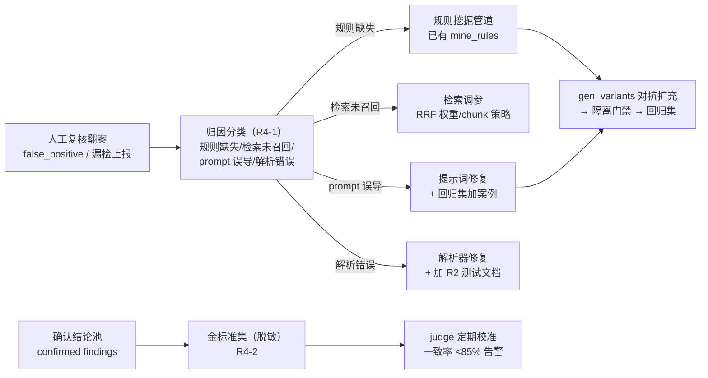
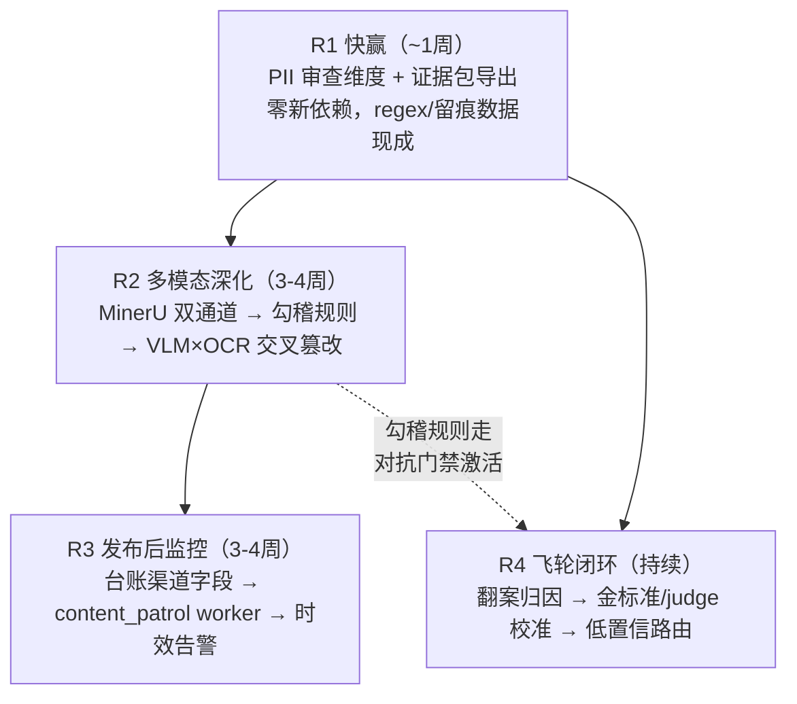

# 产品优化升级方案（调研驱动 · v2 代码核实版）

> 2026-10-04 · v2.1：v2 重写后自审一轮，修正**四个写得过于乐观的实现假设**（VLM 数字可靠性未验证/勾稽字段映射被低估/网页指纹不能精确 hash/估时无 spike 兜底），每个乐观假设现在都配了验证手段或 Plan B 触发条件。v2 主干：逐一核实 `src/services` 全部 17 个服务与路由接线后修正 v1 谎报。调研输入：20+ 对标产品与机构案例 + 源码核实。

---

## 〇、诚实复盘（v1 → v2 修正了什么）

| v1 误判 | 实际状态（代码核实） |
|---|---|
| "Q1-1 一键合规改写待建" | ✅ **已上线**：`review_copilot.rewrite_compliant` + `POST /results/{id}/rewrite` + 前端 `api/ai.ts`；同模块还带问答 Copilot（ask）、报告综述（summary）、复核建议（verdict advice）三件套 |
| "Q1-2 版本 diff 增量审查待建" | ✅ **已上线**：`diff_service`（difflib 块级比对）+ `execute_review` 对比模式——只审"变更块+上下文窗口"，`task.diff_changes` 落库 |
| "Q2-3 海报视觉审查待建" | ✅ **已上线**：`visual_scan`（qwen-vl-plus 五维视觉清单：数字放大强调/保本视觉强化/图形暗示/风险提示弱化/名人背书），`source=vlm` 融入 `conflict_resolve`，永不自动确认 |
| "证据核验（引用幻觉拦截）" | ✅ 已生产化：`evidence.py` 三态语义，不可支撑结论标 ⚠️ 强制人工复核 |
| "飞轮完全没有" | ◐ 部分存在：`rule_tuning.py` 已做规则精调（停用/删词/抬阈值三动作），但翻案→对抗样本→门禁的回流管道没有 |

**教训**：README 的"已知限制"清单落后于代码现状，gap 分析必须以源码为准。

---

## 一、真实能力基线（代码核实后）

**已具备（第一梯队，继续保持，方案不再重复建设）**：

**核实确认的真缺口（本方案的对象）**：

| # | 缺口 | 核实依据 |
|---|---|---|
| 1 | **PII 敏感信息审查维度缺失** | `utils/masking.py` 只做存储脱敏（身份证/手机/卡号 regex 已有），不作为审查维度——营销材料嵌入真实客户信息是 AllocateRite 的核心场景，本项目的 regex 资产可直接复用，差距极小 |
| 2 | **监管取证证据包导出缺失** | `reports.py` 无 zip/export 端点；审计留痕数据都在（task_sign_off/audit_log/采纳记录），缺一个打包出口 |
| 3 | **表格数字勾稽能力缺失** | `xlsx_parser` 只解析不校验；规则引擎无 consistency 类规则——数字类违规 LLM 天然不可靠，慧营靠近千个勾稽检查项取胜 |
| 4 | **复杂版式解析薄弱** | parsers 只有基础 pdf/docx/ocr，扫描件与跨页表格结构丢失 |
| 5 | **发布后监控完全缺失** | `ProductMaterial` 无发布渠道/URL 字段（已核实模型定义）；`regulation_monitor` 只盯监管源（PBC/NFRA/CSRC），无自有内容巡检 worker |
| 6 | **飞轮最后一公里断链** | 翻案项无归因管道；judge 未经金标准校准（README 已坦白）；复核队列无低置信排序 |

---

## 二、对标调研精要（修正映射后保留）

| 对标 | 可抄的点 | 映射到本项目 |
|---|---|---|
| **Red Marker**（IntelligenceBank） | Web Reports 已上线内容定期扫描 + Domain Discovery 未知投放域名发现 | R3 发布后巡检的原型；Domain Discovery 作为 R3 远期扩展 |
| **AllocateRite**（2025-10 新品） | 营销材料内嵌 PII 泄露检测（factsheet/视频/社媒 20+ 格式） | R1-1 直接对标——且本项目 regex 资产现成 |
| **恒生"慧营"** | 近千个数据勾稽/一致性检查项；合同字段抽取 95%+；diff 高亮 | R2 勾稽规则库的产品形态证明 |
| **Greenboard** | WORM 合规存档、books-and-records、审计就绪 | R1-2 证据包导出的内容清单参照 |
| **Google Ads 零样本图审**（WSDM'25） | 政策→LLM 文本描述→图文共嵌入→零样本分类；标注图反哺描述库 | 视觉审查已建，此模式的借鉴点转为 R4：翻案样本反哺 VLM 提示词/规则描述库 |
| **Arize/NeMo 数据飞轮** | online eval 识别失败→低置信路由人工→金标准→定向改进；"不要盲目把纠正当训练信号" | R4 飞轮闭环的架构参照 |
| **花旗 RegTech** | 事后核查→实时预警转型，处理速度翻倍 | R3 的价值叙事（把"实时"延伸到发布后） |
| **MinerU 2.5 / Docling** | 97.5 mAP 版面检测/表格结构保留 vs Apache-2.0 快速通道 | R2-1 双通道设计依据 |

**结论**：v1 的调研方向不变——缺口确实集中在多模态深化/发布后监控/证据出口/飞轮闭环四块，但**体验层（改写/diff）已不是缺口**，重心后移。

---

## 三、需求卡（技术落点版）

### R1 快赢 · 两个小改动（约 1 周，零新依赖）

**R1-1 PII 敏感信息审查维度（对标 AllocateRite）**
- 落点：`rule_engine/engine.py` 新增内置 PII 规则组（非 DSL 用户规则，代码内置、不可停用），regex 复用 `utils/masking.py` 的 `_ID_CARD/_PHONE` 模式 + 追加银行卡 Luhn 校验、邮箱、微信号模式；命中即 high 风险 + source=rule（采信级）
- 报告叙事："材料包含疑似真实客户信息（身份证/手机号/卡号）"——与"脱敏"区分：审查视角是**不该出现**而非遮蔽
- 验收：20 案例合成检测集（含校验位合法的假身份证、座机、400 号码负样本）召回 100% / 误报 0%
- 边界：OCR 截图中的 PII 由视觉通道覆盖（visual_scan 提示词已可报"疑似证件截图"，R2 补一条专项检查项即可）

**R1-2 监管取证证据包导出（对标 Greenboard books-and-records）**
- 落点：`reports.py` 新增 `GET /tasks/{id}/evidence-pack`（zip 流式下载）：最终报告 PDF + 命中条款原文（regulation/article 已关联）+ 每条结论的完整生命周期（检出→复核→确认/翻案→签核人/时间戳）+ 双引擎命中详情 + `evidence_supported` 三态标记 + stage_log 全程耗时
- 数据全部现成（task_sign_off 表、audit_log、review 留痕），纯出口工程
- 验收：一致性自检进 tests——zip 内容与 DB 留痕逐条对得上；监管问"当时凭什么放行"时一键举证
- 加分项：manifest.json 带 SHA256，包自身可验证完整性

### R2 多模态深化（3–4 周，1 个新依赖）

**R2-1 解析双通道（MinerU 深解析 / 现有快速通道）——spike 已跑：PASS 带一条硬性设计要求**
- **Spike 结果（2026-10-04，mineru 4.0.10，本机 CPU，`scripts/spike/mineru_parse_test.py`）**：
  - **表格还原：两张收益演示表 100% 完美**——markdown 表格结构、表头、千分位数字（925.00/100,925.00/1,868.00/103,846.00）全对，R2-2 勾稽的输入质量达标
  - 数字召回 96.2%（25/26）；性能 CPU 可行（推理 ~10s/2 页 = 0.2 页/s，一份 20 页材料约 100 秒，审查本就是异步任务可接受）；冷启动含模型下载 709MB×3 约 14.5 分钟（一次性）
  - **⚠️ 发现真问题：静默漏块**——页1 深蓝底反白标题栏、风险提示行、产品登记编码行被整块漏掉，advanced tier 同样漏（无收益，弃用）。对审查场景"风险提示被静默漏掉"不可接受
- **设计修正（v2.2）：文本完整性互校升级为硬性要求**——MinerU 结构化输出（表格/版式）+ rapidocr 全文兜底（项目已有 rapidocr-onnxruntime）双通道互校：按页比对文本块，MinerU 漏的块从 OCR 通道补入，跨通道差异块标"解析低置信"。互校模式与 R2-3 同构——**互校是本项目的通用防腐剂**
- **工程集成路径已验证**：绕过 4.x 的 CLI/server 架构（其 daemon 在本机 SQLite 报 readonly 崩溃，与解析无关），直接调 Python API `MinerUParser(tier="standard").parse(path)`——已跑通
- 落点：`parsers/mineru_parser.py` 新增 MinerU 通道（内部再分"MinerU 主路 + rapidocr 兜底互校"）；`document_service` 按文档特征路由；许可证 AGPL-3.0 自用无传染（未来私有化分发切 Docling 的预留保留）
- 验收：10 份复杂版式文档，表格结构人工评分 ≥90% + **文本块互校零静默丢失**（每页块数对账进 stage_log）

**R2-2 表格数字勾稽规则引擎（对标慧营勾稽检查项库）**
- 落点：`rule_engine` 扩展 `rule_type=consistency`——规则输入不再是文本流而是表格 JSON + 全文抽取的数值断言；首批 15 条检查项三组：
  - 表内一致：`年化收益率 × 期初本金 ≈ 期末金额`（容差 1%）
  - 跨位置一致：正文宣称收益率 ∈ 演示表区间；海报大字数字 = 表格数字
  - 披露完备：演示表必须含"过往业绩不代表未来表现"且与收益数字同页/同视野
- **被低估的难点（v2.1 补）——表格语义映射**：MinerU 给的是结构化单元格，不是语义字段。哪个 cell 是"收益率"、哪个是"本金"，表头异构严重（"预期年化收益率" vs "业绩比较基准" vs "近一年年化"），不能写死列号。分两层：①正则模板层——常见表头模式匹配（首批覆盖 10 类典型演示表表头，模板库随数据飞轮沉淀）；②LLM 辅助映射层——模板未命中时 LLM 判定列语义，但映射结果仅生成勾稽规则**草稿**，走人工确认后模板才固化。映射准确率是勾稽检出率的天花板， spike 先用 10 份真实演示表测模板层覆盖率（目标 ≥70%，低于则调表头模式库再开工）
- 级联误差对策：勾稽命中附"表格解析置信度"（MinerU 给出），低置信自动降为"待人工核表格"
- 验收：构造含数字不一致的演示集检出 ≥90%；这也是双引擎必要性的新证据——数字计算是 LLM 弱项、规则强项
- DSL 设计原则：勾稽规则同样走 draft→对抗验证→隔离门禁的现有激活管道，复用数据飞轮全部质量关卡

**R2-3 VLM×OCR 交叉篡改检测（差异化创新点，spike 已跑：条件通过）**
- 洞察：`visual_scan`（看图）与 `ocr_parser`（读字）是两条独立通道，业界无人把它们**互校**——视觉层读出的数字与 OCR 文本的数字不一致 = 图片被局部篡改（P 图改收益率是真实黑产手法）
- **Spike 结果（2026-10-04，`scripts/spike/vlm_number_reading.py`，10 张合成海报/39 个数字，qwen-vl）**：
  - 全数字口径：检出率 89.7%（35/39），幻觉 **0**
  - 失败模式剖析：漏的 4 个全是嵌在名词/量词里的单字数字（"理财**1**号"序号、"R**3**级"风险等级、"**1**万元"、"**1**分钱"）——均不在篡改威胁模型内（P 图改的是利率/金额，不是产品序号）
  - **关键数字口径（利率/金额/期限/日期/编号）：35/35 = 100% 检出，零幻觉**——千分位数字正确归一，低分辨率下利率仍正确，precision = 1.0 意味着 VLM 报出的每个数字都真实存在（交叉校验零误报来源）
- **结论：条件通过——VLM 直读方案立项，设计加一层关键数字过滤**（利用 VLM 已输出的 context 标签，只对"利率/金额/百分比/期限/日期"类数字做交叉比对，嵌名单字数字排除）。原判据"全数字 ≥95%"是 spike 中途发现的标注口径偏差（分母混入非目标数字），非 VLM 能力缺陷
- 落点：`conflict_resolve` 新增交叉校验步骤：VLM 输出的**关键数字集**与 OCR 全文数字集比对，不一致项升级为"疑似篡改"高风险
- 验收：合成 5 张 P 图样本（改利率数字/改期限）检出 ≥4；一致样本零误报
- 复现：`"D:\AI\ACD\envs\llmXM\python.exe" scripts/spike/vlm_number_reading.py`，明细 `data/spike_vlm/report.json`

### R3 发布后监控（3–4 周，复用 poller + 影响中心）

**R3-1 已发布内容巡检（对标 Red Marker Web Reports）**
- 数据模型：`ProductMaterial` 加 3 列（走 `scripts/migrate` 既有模式，应用层一致性）：`publish_url`（官网直链）、`channel`（web/wechat/douyin）、`content_fingerprint`（批准版**规范化文本**指纹，v2.1 修正：不是原始 hash——网页渲染文本与批准版 PDF 解析文本天然不一致：空白/顺序/动态时间戳，精确 hash 会天天误报。改为：规范化（去空白/归一标点/剔除动态元素）后存储文本本身 + 相似度阈值判定，≥0.98 视为未变更，0.9–0.98 记"轻微漂移"待观察，<0.9 触发复审。规范化规则先用规则引擎的现有文本清洗资产起步）
- 巡检 worker：复用 `regulation_monitor` 的调度骨架（`fetch_sources` 模式）新建 `content_patrol.py`：定期抓 `publish_url` → 解析 → 与 `content_fingerprint` 比对 → 变更即自动创建复审任务（复用影响中心批量复审 + interrupt 关卡 + 台账升版链）
- 微信公众号：无官方 API，诚实降级为"人工粘贴/截图上传 + diff 比对"入口（挂进现有整改复测 UI，上传即比对）
- 抓取失败（404/下线）→ 台账状态告警"发布状态异常"，进风险驾驶舱
- 验收：demo 覆盖"批准→线上被改→巡检告警→复审→整改"全链路（复用 run_impact_demo 八步模式扩为九步）

**R3-2 时效性告警（数据现成，纯消费方）**
- 落点：材料关联法规的生效/废止状态（regulation 表已有）+ 规则版本状态变化时，反向定位引用它的在用材料（rule_regulation_link 已有）→ 自动生成"待更新"整改项挂进驾驶舱
- 本质是把影响中心"新规→存量材料"的分析能力反向用于"法规废止/规则停用"场景，逻辑对称，复用度高

### R4 飞轮闭环（持续，把断链接上）

**现状断点**：`rule_tuning`（规则精调）与 `gen_variants`（对抗生成）各自为战，中间缺"翻案→归因→样本"的回流管道。

**R4-1 翻案归因管道**
- 落点：新增 `scripts/evaluate/overturn_review.py`（月度 CLI，非常驻）：拉取当月翻案项 → LLM 辅助归因四分类（输出结构化 JSON）→ 生成月度复盘报告（翻案率趋势 / Top 失败模式 / 各管道去向计数）
- 归因结果不自动改任何东西——产出工单式建议，人工确认后走各管道（延续"证据驱动激活"的克制原则）
- 验收：翻案项 100% 有归因标签；复盘报告一键生成

**R4-2 金标准集与 judge 校准**
- 落点：confirmed 结论（含人工最终判定的）脱敏后沉淀为 `golden_cases.json`；`judge.py` 增加 `--calibrate` 模式：与金标准比对输出一致率/分歧清单；一致率 <85% 退出码非零（可接 CI）
- 这直接还掉 README 已知限制里"judge 未经人工金标准校准"的债

**R4-3 低置信优先复核路由**
- 落点：复核队列排序键 = `confidence × 风险等级权重`（字段现成：findings 已带 confidence、severity）；前端复核列表加排序开关
- 对标业界共识"人工只看最难案例"——把最贵的资源放在最需要判断力的地方

---

## 四、分期依赖与节奏

- R1 与 R4 可并行（互不依赖）；R2 的勾稽依赖 R2-1 的表格 JSON；R3 独立性最强，人力充裕时可与 R2 并行
- 每期完成定义（DoD）：功能 + 单测 + 回归门禁不红 + demo 脚本可复现 + README/已知限制清单同步更新（避免 v1 的文档-代码脱节）

---

## 五、不做清单（不变，微调理由）

| 不做 | 理由 |
|---|---|
| 语义相似度 LLM 缓存 | 既定决策：合规判定对措辞极敏感，正确性 > 成本 |
| AI 替代人工终审 | 全部对标案例保留人工终审；监管要求；产品定位 |
| 音视频/直播话术审查 | ASR 链路是新系统；视觉审查（已建）+ R2-3 先把图片吃透 |
| Domain Discovery 未知域名发现 | 爬虫基础设施投入大，远期 |
| 微调自有模型 | 金标准集（R4-2）建成前是伪需求，R4 是它的前置 |
| 创作端插件（Word/Figma） | 已有 MCP（scan_text/review_text）覆盖外部生态，观察需求再说 |
| 法规库全量冲刺 | 重复性劳动非技术缺口，随飞轮扩（已知限制已写明） |

---

## 六、指标口径（升级后目标）

> v2.1 起**沿用 evaluation.md 的双口径传统**：哪些指标进门禁（gate.sh 退出码可接 CI、回归必须不红）、哪些只是观察项（人工评估、不阻塞合并）——v2 把两者混在一张表里是不严谨的，与项目现有方法论不一致。

| 指标 | 现状 | 目标 | 归属 | 口径 |
|---|---|---|---|---|
| PII 检测（材料内嵌客户信息） | 无 | 召回 100% / 误报 0% | R1 | **门禁**（确定性规则，检测集进回归） |
| 证据包导出一致性 | 无 | zip 内容与 DB 留痕 100% 一致 | R1 | **门禁**（一致性自检进 tests） |
| 数字勾稽检出 | 无 | ≥90%（含置信度降级机制） | R2 | **门禁**（构造检测集进 gate） |
| 表头模板覆盖率（语义映射第一层） | 无 | 真实演示表 ≥70% | R2 | **门禁前置**（spike 指标，不达标不开工） |
| VLM 读数准确率（R2-3 spike） | **已验证**：关键数字 100%/全口径 89.7%/零幻觉 | 条件通过（加关键数字过滤） | R2 | **Spike** ✅ 2026-10-04 |
| 复杂版式表格还原 | 无结构化 | 人工评分 ≥90% | R2 | 观察（人工评估，不进 gate；样本固定 10 份可复现） |
| 视觉篡改检测 | 无 | 合成样本 ≥80% 检出、零误报 | R2 | 观察（样本仅 5 张，量太小不足以做门禁；随样本扩容升级口径） |
| 发布后失控窗口 | ∞ | 巡检周期内（默认 7 天）可发现 | R3 | 观察（demo 链路验证，无回归口径） |
| judge×金标准一致率 | 未校准 | ≥85% | R4 | **门禁**（--calibrate 退出码非零，可接 CI） |
| 翻案项归因覆盖 | 无 | 100% 有标签 | R4 | 观察（月报生成，正确性靠人工抽查） |

---

## 七、风险（v2.1 补触发器：每个风险现在有明确的"停下来重新评估"条件）

1. **MinerU 环境可用性**：AGPL 自用无传染；但 MinerU 对 Windows 本地支持一般（GPU 依赖/安装坑），**R2 开工前的 spike（0.5 天）先在本机跑通一份复杂 PDF**——跑不通即触发决策：切 MinerU 官方 API 服务（免运维，按量付费）或 Docling（Apache-2.0，表格结构弱一档）。不允许"开工了才发现环境不通"
2. **勾稽级联误差**：表格识别错 → 勾稽误报；对策已内置（解析置信度降级待人工）+ R2-2 语义映射分层
3. **巡检抓取合规边界**：只抓自己登记的 `publish_url`（已获授权的自有渠道），不做第三方爬取
4. **R3 数据库变更**：走 `scripts/migrate` 既有模式；无外键约定下应用层维护一致性（项目既定）
5. **金标准数据卫生**：延续现有约定——测试期复核数据不冒充人工判断，金标准只收真实人工确认结论
6. **估时口径（v2.1 诚实声明）**：R1 ~1 周 / R2、R3 各 3–4 周均为**复杂度推断值，未经 spike 校准**——两个 spike（MinerU 环境、VLM 读数）完成后应回来修正估时，届时再锁交付节奏

---

## 八、开工前自检清单（"清晰"的定义）

- [x] 缺口清单经源码核实，无谎报（v2 已修正 v1 三处）
- [x] 每张需求卡有文件级落点与可复用资产清单
- [x] 每个乐观假设有验证手段（两个 spike）或 Plan B 触发条件（MinerU 降级链、R2-3 两段式）
- [x] 指标分门禁/观察双口径，与 evaluation.md 方法论对齐
- [x] **Spike 2（VLM 读数）已完成** ✅ 2026-10-04：关键数字 100% 检出/零幻觉，R2-3 条件通过（加关键数字过滤层），复现 `scripts/spike/vlm_number_reading.py`
- [x] **Spike 1（MinerU）已完成** ✅ 2026-10-04：表格解析 100% 还原（R2-2 输入达标）、数字召回 96.2%、CPU 性能可行（~0.2 页/s）；**发现并修正一个真风险**——standard/advanced tier 均静默漏检封面装饰区文本块（含风险提示行），对策：MinerU×rapidocr 文本互校升级为硬性设计；工程路径走 Python API（server daemon 有 SQLite 崩溃 bug 已绕过）；复现 `scripts/spike/mineru_parse_test.py` + `make_test_pdf.py`
- [x] 两个 spike 结果已回报，R2 估时可锁：R2-1 的互校设计增加了工作量，R2 估时 3–4 周 → **4 周**（含互校对账逻辑与测试集）

---

## 九、落地状态总账（2026-10-05）

**R1–R4 四期全部交付**（实现细节见各需求卡与 README 已知限制）：

| 期 | 交付物 | 状态 | 测试 |
|---|---|---|---|
| R1-1 | `pii_scan.py` 内置 PII 检测（身份证 GB11643/Luhn/边界断言） | ✅ 接线 rule_scan | 25 用例全绿 |
| R1-2 | `evidence_pack.py` + `GET /tasks/{id}/evidence-pack`（SHA256 manifest） | ✅ | 6 用例全绿 |
| R2-1 | `mineru_parser.py` 双通道（pypdf 主路 + MinerU 补表格/扫描件） | ✅ 默认关，`parser.mineru_enabled` 开 | 12 用例全绿（mock 引擎） |
| R2-2 | `consistency.py` 勾稽引擎（表头模板 10/10 识别 + 三组检查项） | ✅ 接线 rule_scan | 12 用例全绿 |
| R2-3 | `tamper_check.py` 交叉篡改检测（关键数字过滤） | ✅ 接线 review_service | 10 用例全绿 |
| R3-1 | `content_patrol.py` 发布后巡检（containment+数字双层判定）+ 迁移脚本 + `POST /impact/materials/patrol` | ✅ 手动触发 | 3 纯函数绿 + 8 DB 用例待 MySQL |
| R3-2 | 时效性告警（`stale_materials_check`：规则停用/法规废止反向定位，挂驾驶舱 overview） | ✅ v1 只读清单 + **v2 写入整改清单**（系统容器评估 + sync 端点，复用决策/复测/自动关闭链路） | 7 纯函数 + 16 v2 用例全绿 + 服务层 E2E 7 断言 |
| R4-1 | `overturn_review.py` 翻案归因月度 CLI（四分类/工单式产出/无 LLM 降级） | ✅ | 6 用例全绿 |
| R4-2 | judge `--export-golden` / `--calibrate`（一致率 <85% exit 1 可接 CI） | ✅ | judge 测试全绿 |
| R4-3 | results API `order=priority` 低置信×高风险复核路由 | ✅ 实现 | 排序待 MySQL 验证 |

**遗留清单**：
1. ~~MySQL（Docker Desktop）恢复后：`python scripts/migrate/material_patrol.py` 建列 → 跑全量 DB 用例~~ → **部分完成（2026-10-06 端到端冒烟）**：三个迁移（sign_off / notifications / material_patrol）已跑通并验证端点恢复；**全量 DB 用例仍未跑**（需 MySQL 起时执行：patrol 8 例 + results 排序 + R1 证据包一致性）
2. ~~R2-2 LLM 辅助表头映射（模板层未命中样本的兜底，需 LLM 成本评估）~~ → **已完成（2026-10-07）**：实现为**离线草稿工具** `scripts/tools/header_map_llm.py`（不在审查管线内跑——零运行时 LLM 成本、零误报风险，与方案"草稿+人工确认"口径一致）。流程：扫描文档 → 找 `map_fields` 未命中表头 → LLM 判列语义 → 产出 `data/header_map_drafts.json` 草稿 → 人工确认后并入 `FIELD_PATTERNS`。**实测验证**：异构表头 `投入金额(元)/基准年化(%)/参考收益(元)/结算金额(元)` → 正确映射 4 字段（conf 0.95），非勾稽的"产品要素表"被保守拒绝（不足 2 字段）；建议模式自动剥单位后缀（`投入金额(元)`→`投入金额`，避免换表写"(万元)"即失配）。15 条单测全绿 + ruff clean。**成本**：单次判定约几十 token（离线按需，非管线内）
3. ~~R3-2 v1 为只读清单挂驾驶舱；写入"待更新"整改项（挂 remediation 结构）为后续增强，需跨 assessment 模块设计~~ → **已完成（2026-10-07，R3-2 v2）**：落点为**系统单例容器评估**（`STALE_CONTAINER_TITLE="时效性告警：依据失效待更新材料"`，status=confirmed——语义即"依据失效→反向影响材料"的影响评估，零新增表）。写入走 `POST /impact/materials/stale/sync`（复用 `stale_materials_check` 只读查询 + `merge_stale_entries` 纯函数，按 `stale:{material_id}` 命名空间幂等合并）；条目不落审查任务、按 material_id 定位决策（`decide_remediation`/`RemediationDecision` 扩展）。**打通后自动获得**：整改清单 UI（含失效依据列）、决策留痕、上传整改版复测、复测通过自动关闭、Excel 导出、驾驶舱整改计数。**顺带修 1 处必崩缺陷**：`sync_batch_to_assessment` 的 `retest_map`/`merged` 字典推导按 `entry["task_id"]` 直取——stale 条目无此键，复测回写时必 `KeyError`（改为 `_entry_key` 命名空间键 `task:{id}` / `stale:{material_id}`）。**行为决策**（已拍板）：依据恢复（规则重新启用/法规状态更新）时 pending/整改中条目**自动关闭**并留 `resolved` 说明；人工驳回（reject）与复测通过关闭的不动；系统关闭条目再次失效**自愈重开**。**验证**：16 条新单测（13 纯函数 + 3 DB）+ 28 条 impact 回归 + 11 条 retest/review 全绿；服务层 E2E（真实 MySQL）7 项断言 ALL_PASS（造链路→同步→幂等→决策→依据恢复关闭→再失效重开，完毕还原现场）；前端 typecheck + 71 用例 + build 全绿 + mock 真机验收截图（docs/ui-verify-2026-10-07/05,06）
4. **勾稽检测的脱敏冲突**（2026-10-06 冒烟发现）：解析阶段脱敏（PRD §13.2）会把金额抹成 `***元`，勾稽算术检测在真实管线中无法工作。方案 A（脱敏时记录命中元数据）已救回 PII，但勾稽需要"表格结构 + 数值对应关系"而非"此处有个金额"——待有真实演示表数据时设计（候选：表格片段随 span 传递 / 勾稽前移到脱敏前）
5. **审计日志指向已删结论**（2026-10-06 冒烟发现）：任务重跑会清空旧结论但保留其审计记录（`audit_logs.resource_id` 悬空）——属设计取舍，若需"历史轨迹可回溯到已删结论"要单独设计

**已补齐**：R3-1 调度化 ✅——`scripts/poller/patrol_published.py` 与 poll_regulators 同构（外部计划任务定时调用，建议 7 天周期；`--dry-run` / `--material-ids` / changed+gone 退出码 1 告警；MySQL 不可用优雅报错 exit 2）。
