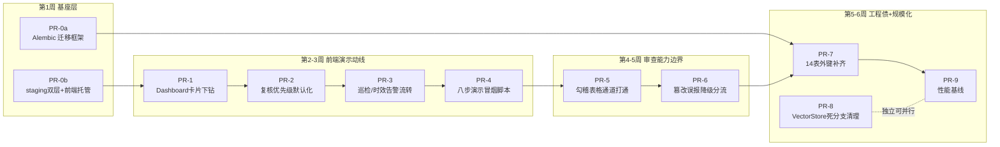
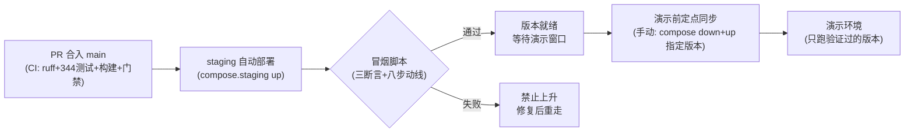

# 重构 PR 需求方案与实现细节

> 版本：v1.0（2026-10-08）
> 战略排序：**演示优先**（前端体验 → 审查能力 → 规模化+工程债合并）
> 周期与粒度：4–6 周 / 11 个 PR / 垂直切片（每 PR 合入即可演示）
> 前置事实：项目 git 仓库已就绪（`main` 分支，工作树干净）——CLAUDE.md 中"本项目无 git 仓库"的描述已过时，本方案按真 git PR 流程设计。

---

## 1. 重构背景与目标

### 1.1 痛点清单（按四大方向）

**方向 A：审查能力边界（业务核心露馅处）**

| # | 痛点 | 现状依据 |
|---|---|---|
| A1 | **勾稽引擎只在 MinerU 通道生效，而 MinerU 默认关**——文字版 PDF 走 pypdf 文本层，表格为乱序碎片，勾稽完全不生效。演示被问"表格数字勾稽"时，默认配置下是空转的 | README 已知限制：勾稽规则引擎（R2-2）v1 只消费 markdown 表格块（MinerU 通道产物） |
| A2 | **篡改检测的 OCR 漏读误报**——VLM 读到的数字 OCR 未读到时，一票判 changed，产出假"疑似篡改"进人工核验 | README 已知限制：OCR 漏读小字数字是残余误报源 |
| A3 | **巡检只有授权自有渠道**，公众号需人工粘贴兜底——渠道覆盖面在真实工作需求下不够 | README 已知限制（R3-1）v1 边界 |

**方向 B：规模化/性能瓶颈（范围收窄说明）**

知识库扩容已明确排除（数据飞轮已建成，属重复性劳动）。本方向在排除后的可执行子集收窄为：

| # | 痛点 | 现状依据 |
|---|---|---|
| B1 | **并发审查吞吐无基线数**——线程池默认配置下的吞吐/延迟从未测过，规模化是无尺子的黑盒 | 无任何 bench 脚本；docs/benchmark.md 只有准确率基准 |
| B2 | **VectorStore 抽象留有 Milvus 死分支**（`NotImplementedError`）——维护面虚胖，误导后来者以为有第二实现 | `src/infrastructure/vectorstore/base.py` / `factory.py` |

**方向 C：前端体验断层（演示动线的实际堵点）**

R1–R4 后端能力前端已有**基础接线**（evidence-pack 下载按钮、Dashboard patrol/stale 计数卡片、results API `order=priority` 参数均已存在），断层在**消费深度**：

| # | 痛点 | 现状依据 |
|---|---|---|
| C1 | Dashboard 风险卡片（patrol_changed / patrol_gone / stale_count）**纯展示无下钻**，点不进去 | `DashboardView.vue` statCards 数组仅渲染 count |
| C2 | 复核队列 `order='priority'`（低置信×高风险优先）**API 支持但前端未默认启用**，复核员看到的还是自然序 | `results.ts` 已定义参数，调用方未传 |
| C3 | 巡检 changed/gone **只有计数无详情**，diff 内容、stale 材料到整改清单的流转断链 | MaterialLedgerView 无 diff 详情视图 |
| C4 | **无演示动线保障**——八步演示（登录→上传→审查→复核→签发→证据包→影响中心→整改）没有任何自动化冒烟，每次演示靠手工碰运气 | 无 smoke 脚本 |

**方向 D：工程质量债（走向真实交付的障碍）**

| # | 痛点 | 现状依据 |
|---|---|---|
| D1 | **14 张业务表零外键**，一致性全靠应用层自觉，脏数据风险随功能增长放大 | README 已知限制 |
| D2 | **无迁移框架**——表结构变更无版本化脚本，Alembic 未引入（requirements.txt 无此依赖），schema 演进不可审计 | requirements.txt 核查 |
| D3 | **无 staging 环境**——代码合入即等于上演示环境，演示前一天合入的 PR 直接暴露 | docker/ 下仅一套 compose |
| D4 | **前端未生产托管**——演示要起 Vite dev server，不专业且有性能损耗 | CI 仅验证可构建 |

### 1.2 重构目标（量化）

| 目标 | 指标 | 基线 | 达成判据 |
|---|---|---|---|
| 勾稽引擎默认生效 | 不开 MinerU 时文字版 PDF 表格勾稽识别 | 0/10（不生效） | 10 类典型演示表样本 **10/10** |
| 篡改误报分流 | VLM读到/OCR未读数字的误判 changed | 100% 一票判 | **0% 直接判定**，全部降级"待人工核验"并两路数字并排展示 |
| R1–R4 深度消费 | 下钻/默认排序/详情流转/冒烟 | 4 项均为 0 | **4/4**（卡片可下钻、priority 默认、巡检详情可流转、八步冒烟通过） |
| Schema 可审计演进 | 外键覆盖 + 迁移可重放 | 0/14 表，无迁移框架 | **14/14 表外键**；`upgrade→downgrade→upgrade` 幂等循环通过 |
| 部署双层化 | staging + 演示环境分离 | 单层 | staging 冒烟通过才允许同步演示环境；前端 nginx 托管 |
| 性能有尺子 | 并发吞吐 + 检索延迟基线 | 无数据 | 并发 5/10/20 三档吞吐数 + 检索 p50/p95 写入 docs/benchmark.md |
| 质量零回归 | 全程门禁 | 344 用例 + 评估门禁（召回≥0.98/误报≤0.02） | 每个 PR 零回归，最终门禁全绿 |

---

## 2. 重构范围界定

### 2.1 纳入范围

| 层 | 模块 | 动作 |
|---|---|---|
| 前端 | `DashboardView` / `TaskDetailView` / `MaterialLedgerView` / `ImpactCenterView` + `api/results.ts` `api/impact.ts` | 视图内打磨（**导航与页面结构不动**）：下钻、默认排序、详情流转、标识增强 |
| 后端-审查 | `src/parsers/`（表格通道）、`src/services/tamper_check.py` `visual_scan.py` | 勾稽通道打通、误报降级分流 |
| 后端-工程 | `migrations/`（新建 Alembic）、`src/models/`（外键）、`src/infrastructure/vectorstore/`（死分支清理） | 迁移框架、外键补齐、收敛维护面 |
| 部署 | `docker/`（staging compose + Dockerfile.frontend + nginx）、`scripts/demo/`（冒烟）、`scripts/bench/`（新建基线） | 双层环境、动线保障、性能尺子 |

### 2.2 明确排除（边界）

| 排除项 | 理由 |
|---|---|
| 多租户 / 组织级数据隔离 | 另一量级工程，RBAC 已满足当前需求，4–6 周塞不下 |
| 知识库扩规模（法规/罚单数量） | 数据飞轮已建成，属重复性劳动非重构 |
| Celery/Redis 队列主架构改造 | 线程池默认 + 队列可选 + 自动回退已稳定，非痛点主轴 |
| MinerU/OCR/VLM 选型替换升级 | spike 已验证能力边界，本次只做通道打通与逻辑分流，不动选型 |
| 前端信息架构重排（导航/页面合并拆分） | 演示前风险过大；视图内打磨已够达成演示目标 |
| MCP 契约变更 | `scan_text`/`search_regulations`/`review_text` 是对外契约（Claude Desktop 等客户端在用），**冻结不动** |

---

## 3. PR 需求方案（11 个 PR，垂直切片）

### 3.1 PR 依赖与提交顺序总览

提交节奏：第 1 周 PR-0a ∥ PR-0b → 第 2 周 PR-1、PR-2 → 第 3 周 PR-3、PR-4（演示动线收口）→ 第 4 周 PR-5（含前置 spike）→ 第 5 周 PR-6、PR-7 → 第 6 周 PR-8、PR-9 + 演示彩排缓冲。**任一 PR 落后超过 3 天，砍当期最低优先级 PR（PR-8 → PR-9 顺序砍）保演示日期。**

### 3.2 PR 明细

#### PR-0a [基座] Alembic 迁移框架接入

| 项 | 内容 |
|---|---|
| 涉及文件 | `migrations/`（新建：env.py + versions/）、`src/infrastructure/database/`（启动初始化路径改为 upgrade）、`requirements.txt`（+`alembic>=1.13`）、CI workflow（初始化步骤替换） |
| 变更类型 | 新增（迁移目录）+ 修改（初始化路径、依赖） |
| 依赖 | 无 |
| 验收标准 | ① 全新库 `alembic upgrade head` 与 `Base.metadata.create_all` 产出 schema **diff 为空**（表/列/索引逐项对比脚本验证）；② 现有库 `alembic stamp head` 无损；③ 344 测试零回归 + ruff 绿；④ 后续 PR 一律以 migration 文件管 schema，`create_all` 双轨路径下线 |

#### PR-0b [基座] staging 双层环境 + 前端生产托管

| 项 | 内容 |
|---|---|
| 涉及文件 | `docker/docker-compose.staging.yml`（新建：端口错开——API 8001 / MySQL 3308 / 前端 8081，容器名 `staging-` 前缀）、`docker/Dockerfile.frontend`（新建：多阶段构建 node→nginx）、`docker/nginx.conf`（新建：静态托管 + `/api/v1` 反代）、`scripts/demo/smoke_staging.sh`（新建：健康检查+登录+任务列表三断言） |
| 变更类型 | 新增 |
| 依赖 | 无（与 PR-0a 并行） |
| 验收标准 | ① `docker compose -f docker/docker-compose.staging.yml up -d` 后 `/api/v1/health` 绿；② `http://localhost:8081` 可登录且 API 反代通；③ 冒烟脚本三断言通过、失败退出码 1；④ 与默认 profile（3306/3307/8000）共存无端口冲突 |

#### PR-1 [前端] Dashboard 风险卡片下钻

| 项 | 内容 |
|---|---|
| 涉及文件 | `frontend/src/views/dashboard/DashboardView.vue`（statCards 增加路由跳转）、`frontend/src/views/impact/MaterialLedgerView.vue`（URL query 筛选态：`?filter=patrol_changed` 等）、`frontend/src/views/impact/ImpactCenterView.vue`（stale tab 定位）、`frontend/src/router/routes.ts`（query 透传如需） |
| 变更类型 | 修改 |
| 依赖 | PR-0b（staging 为验收载体） |
| 验收标准 | ① `patrol_changed`/`patrol_gone`/`stale_materials` 三卡片可点击，跳转对应过滤清单；② 刷新后筛选态经 query 参数保持；③ 计数为 0 时卡片置灰不可点；④ 前端构建绿 + 344 测试零回归 |

#### PR-2 [前端] 复核工作台优先级路由默认化

| 项 | 内容 |
|---|---|
| 涉及文件 | `frontend/src/api/results.ts`（`listResults` 默认传 `order='priority'`）、`frontend/src/views/task/TaskDetailView.vue`（人工复核 Tab：行级置信度×风险徽标、排序可切换）、复核列表组件（`frontend/src/components/` 下对应组件） |
| 变更类型 | 修改 |
| 依赖 | PR-1（同视图群打磨） |
| 验收标准 | ① 待复核列表默认低置信×高风险优先；② 每行显示来源（rule/llm/hybrid）与风险等级徽标，低置信×高风险行高亮；③ 排序可切回自然序（演示"普通队列"场景）；④ 构建 + 测试绿 |

#### PR-3 [前端] 巡检详情与时效告警完整流转

| 项 | 内容 |
|---|---|
| 涉及文件 | `frontend/src/views/impact/MaterialLedgerView.vue`（巡检 changed/gone 的 diff 详情抽屉）、`frontend/src/api/impact.ts`（如后端字段不足则同步补齐 `src/api/routers/impact.py`）、`frontend/src/views/impact/ImpactCenterView.vue`（stale 一键同步 → 整改清单跳转 → `retestMaterial` 上传整改版 v2 全链路引导） |
| 变更类型 | 修改（后端最多字段级补充，不动契约结构） |
| 依赖 | PR-1 |
| 验收标准 | ① patrol changed 材料可查看 diff 详情（批准版 vs 线上版关键差异）；② stale 同步后一键跳转整改清单且新条目高亮；③ 从整改清单上传整改版走通升版 v2 → 复测 → 自动关闭动线；④ 构建 + 测试绿 |

#### PR-4 [演示] 八步演示动线冒烟脚本

| 项 | 内容 |
|---|---|
| 涉及文件 | `scripts/demo/smoke_demo_flow.py`（新建，API 级：登录→上传→审查→人工复核→签发→证据包下载→影响中心概览→整改闭环，八步断言）、`docs/`（演示动线说明一页） |
| 变更类型 | 新增 |
| 依赖 | PR-0b、PR-1~PR-3（验证其成果） |
| 验收标准 | ① 八步在 staging 全通过，任一步失败退出码 1 并打印失败步与响应体；② 证据包下载后 zip 内 manifest SHA256 校验通过（复用后端校验逻辑）；③ 脚本可重复执行（幂等：每次创建新任务不依赖前次状态）；④ **此脚本成为后续所有 PR 的部署验收步骤**（合入 staging 后必跑） |

#### PR-5 [审查] 勾稽引擎表格通道打通（文字版 PDF）

| 项 | 内容 |
|---|---|
| 涉及文件 | `src/parsers/`（新增 pdfplumber 表格抽取 adapter，产出与 MinerU 同构的 markdown 表格块）、`src/parsers/chunker.py`（表格块与 pypdf 文本块合流）、`tests/`（新增通道单测：10 类典型演示表样本） |
| 变更类型 | 新增 + 修改 |
| 依赖 | PR-4（用其作部署验收） |
| 验收标准 | ① **不开 MinerU** 时文字版 PDF 表格勾稽生效：10 类典型表样本 10/10（含货基/保险表正确跳过）；② pypdf 文本层主路零变化（封面装饰区文本块行为不变，MinerU 漏检教训不重蹈）；③ 344+新增测试零回归；④ 评估门禁不红（召回≥0.98/误报≤0.02） |
| 前置 spike | 动手前先用 pdfplumber 跑 10 类样本识别率 spike——达标（≥8/10）才按本方案实施；不达标降级方案 B：MinerU 默认开启 + 封面漏检区域告警标注（勾稽生效但接受 MinerU 边界，PR 描述中如实记录降级决策） |

#### PR-6 [审查] 篡改检测 OCR 漏读降级分流

| 项 | 内容 |
|---|---|
| 涉及文件 | `src/services/tamper_check.py`（比对逻辑：VLM 读到/OCR 未读的数字不再一票判 changed）、`src/services/visual_scan.py`（输出两路数字与降级标记）、`frontend/src/views/task/TaskDetailView.vue`（疑似篡改结论展示两路数字并排对照 + "待人工核验"状态） |
| 变更类型 | 修改 |
| 依赖 | PR-2（同视图交互）、PR-5（同期收口） |
| 验收标准 | ① VLM读到/OCR未读数字 → 降级"待人工核验"而非 changed，复核界面两路数字并排；② **既有真篡改样本检出率不降**（构造篡改用例回归：数字被改仍一票判 changed）；③ 测试 + 门禁绿 |

#### PR-7 [工程债] 14 表外键补齐（Alembic 迁移）

| 项 | 内容 |
|---|---|
| 涉及文件 | `migrations/versions/xxxx_add_foreign_keys.py`（新建，逐表外键）、`scripts/maintenance/orphan_cleanup.py`（新建：迁移前置孤儿行清洗，删除策略 + 审计日志落盘）、`src/models/`（relationship 最小补齐，仅外键对应处） |
| 变更类型 | 新增 |
| 依赖 | PR-0a（迁移框架） |
| 验收标准 | ① 全新库 `upgrade→downgrade→upgrade` 幂等循环通过；② 清洗脚本处理孤儿行且留审计记录（演示数据可重导策略兜底，但脚本必须完整可执行）；③ 加外键后 344 测试零回归（应用层一致性逻辑与 DB 约束共存无冲突）；④ `scripts/init_data/` 全套重导路径不受影响 |

#### PR-8 [工程债] VectorStore 死分支清理

| 项 | 内容 |
|---|---|
| 涉及文件 | `src/infrastructure/vectorstore/base.py` `factory.py` `chroma.py`（删除 Milvus `NotImplementedError` 分支，Chroma 收敛为唯一实现）、`tests/`（对应调整）、`README.md`（诚实清单更新该条） |
| 变更类型 | 修改 + 删除 |
| 依赖 | 无强依赖（可与 PR-9 并行） |
| 验收标准 | ① 死代码移除后 ruff + 测试绿、导入图干净；② Chroma 检索功能回归（评估门禁不红）；③ README 已知限制条目更新（说明决策：当前 809 条款规模 Chroma 无压力，扩展点需要时再引入，避免维护死代码） |
| 决策说明 | 备选方案是真正实现 Milvus 分支——但知识库扩容已排除出范围，实现后无真实工作负载验证，属"为不存在的规模写代码"，故选择清理。此决策若后续知识库上量可翻案 |

#### PR-9 [规模化] 并发与检索性能基线

| 项 | 内容 |
|---|---|
| 涉及文件 | `scripts/bench/bench_review_throughput.py`（新建：线程池并发 5/10/20 任务，记录吞吐与延迟分布）、`scripts/bench/bench_retrieval_latency.py`（新建：regulation_match 混合检索 p50/p95）、`docs/benchmark.md`（追加基线章节） |
| 变更类型 | 新增 |
| 依赖 | PR-4（复用其造数与任务创建逻辑） |
| 验收标准 | ① 三档并发吞吐数 + 检索 p50/p95 首次成文写入 docs/benchmark.md；② 脚本可重复执行（固定种子，两次运行偏差 <5%）；③ 作为 CI 可选 job（不进门禁，手动触发）；④ 基线数成为下次"规模化"立项的判据 |

---

## 4. 实现方案细节

### 4.1 核心点一：Alembic 接入与 schema 单轨化

**现状**：无迁移框架，schema 由 `Base.metadata.create_all` 在启动时建出——变更不可审计、不可回滚、不可重放。

**实现思路**：
1. `alembic init migrations`，`env.py` 的 `target_metadata` 指向项目 `Base.metadata`（`compare_type=True` 开启类型对比，为后续 autogenerate 提供精度）。
2. **baseline 迁移**：手写 `0001_baseline.py`，内容 = `Base.metadata.create_all` 的等价 DDL 快照（14 业务表 + 2 checkpoint 表）。验证方法：两个全新库分别 `create_all` 与 `alembic upgrade head`，用 `information_schema` 逐表逐列 diff，空即通过。
3. **双轨下线**：启动初始化路径从 `create_all` 改为 `alembic upgrade head`（程序化调用 `command.upgrade(config, "head")`）；开发新库与 CI 全走 Alembic。风险点：CI 现有初始化配方需同步替换，否则双轨漂移——**CI 替换是本 PR 验收的硬条件，不是可选项**。
4. 现有库执行 `alembic stamp head` 标记基线，不重放 DDL。

**技术选型理由**：Alembic 是 SQLAlchemy 官方配对迁移工具（项目 SQLAlchemy 2.0），autogenerate 与 ORM 元数据同源，零阻抗； opposed to 手写 SQL 迁移脚本——无版本链、无 downgrade、不可重放。

### 4.2 核心点二：staging 双层与前端生产托管

**实现思路**：
1. `docker-compose.staging.yml` 复用现有 service 定义（`extends` 或直接复制改参），端口错开：API 8001 / MySQL 3308 / 前端 8081；容器名统一 `staging-` 前缀避免与默认 profile 撞名。MySQL 数据卷独立（`staging-mysql-data`），演示环境数据不被 staging 污染。
2. `Dockerfile.frontend` 多阶段构建：`node:20-alpine` 执行 `npm ci && npm run build` → `nginx:alpine` 托管 `dist/`；`nginx.conf` 做 `/api/v1` 反代到 api 服务（替代 Vite dev proxy 的角色）。演示环境与 staging 用同一镜像，仅环境变量差异。
3. 冒烟脚本最小三断言：`/api/v1/health` 200 → 登录拿 token → `GET /api/v1/tasks` 200。失败退出码 1 供计划任务/人工告警。

**风险与应对**：
- *风险*：同机双套 MySQL 内存占用（8GB 内存机器吃紧）。*应对*：staging MySQL 容器加 `mem_limit: 512m`（演示数据量级足够），Neo4j/graph profile 在 staging 默认不启。
- *风险*：前端构建产物与 dev 模式行为差异（如环境变量未注入）。*应对*：`VITE_API_TARGET` 类变量在 staging 构建时显式注入，PR-0b 验收即发现此问题（这正是生产托管提前的价值）。

### 4.3 核心点三：勾稽表格通道打通（PR-5，技术最重的 PR）

**现状链路**：文字版 PDF → pypdf 文本层 → chunk（表格成乱序碎片）→ 勾稽引擎只认 markdown 表格块（MinerU 产物）→ **默认配置下勾稽空转**。

**实现思路**（方案 A，spike 达标后走）：
1. 新增 `src/parsers/pdf_table_adapter.py`：pdfplumber `extract_tables()` 抽取表格 → 转为与 MinerU 同构的 markdown 表格块（含表头语义映射所需的行列结构）。
2. chunker 合流：pypdf 文本块（主路，保封面不漏检）+ pdfplumber 表格块（勾稽专用），表格块打 `source='pdfplumber'` 标记。**MinerU"只补不替"的原则复用于 pdfplumber**——表格块只增不改文本块，数字差异同样进互校日志。
3. 勾稽引擎（R2-2）零改动——它消费的是统一格式，通道在解析层合流。
4. 表头语义映射模板（10 类典型演示表）需在 pdfplumber 产物上重新验证——单测样本直接复用现有 10 类样本集。

**降级方案 B**（spike <8/10 时）：MinerU 默认开启，接受其封面漏检边界但在报告定位处显式告警标注"深解析通道，封面区域可能有未覆盖文本"。PR 描述如实记录 spike 数据与降级决策——**不允许静默降级**。

**技术选型理由**：pdfplumber 纯 Python、无外部服务依赖、对中文 PDF 表格的格子坐标抽取稳定（camelot 需 ghostscript 且对无框表格弱；不改 MinerU 选型是已排除项）。选它不是因为最好，是因为"pypdf 主路 + pdfplumber 只补表格"的组合风险最小。

### 4.4 核心点四：篡改误报降级分流（PR-6）

**现状链路**：VLM 读出关键数字 → 与 OCR/文档数字集合比对 → VLM 有而集合无 → 一票判 changed（"数字被改"）→ 但真实原因常常是 OCR 漏读了小字数字 → 误报。

**实现思路**：
1. `tamper_check.py` 比对逻辑改为三分支：`集合有且相等` → 一致；`集合有但不等` → 一票判 changed（真篡改，保留现状）；`集合无此数字` → **降级 `unverified`（待人工核验）**，不再判 changed。
2. `visual_scan.py` 输出结构增加 `ocr_missing: [...]` 字段，携带两路数字（VLM 读到值 + 位置）。
3. 前端 TaskDetailView 疑似篡改结论区：`unverified` 条目渲染两路数字并排 + "OCR 未读到，请人工核对原图"引导文案；复核操作不变（人工确认/剔除误报路径复用现有 confirm 流）。
4. **回归红线**：构造篡改用例（集合有但不等）检出率必须 100% 不降——降级只影响"集合无"分支，这在逻辑上是可分离的，单测覆盖三条分支各至少 3 例。

**风险与应对**：*风险*：OCR 系统性漏读某文档全部数字 → 大量 unverified 涌入人工队列，复核负担反增。*应对*：单文档 unverified 占比 >50% 时聚合为一条"该文档 OCR 质量低，建议整档人工核对"的汇总条目，不逐条轰炸。

### 4.5 核心点五：外键补齐的迁移安全（PR-7）

**实现思路**：
1. 前置清洗脚本先跑：14 表按外键图逐表查孤儿行（如 `results.task_id` 无对应 task），演示数据策略=删除并落审计日志（`scripts/maintenance/orphan_cleanup.py` 输出 `data/audits/orphan_cleanup_<date>.json`）。
2. 迁移脚本逐表加 FK（`ON DELETE CASCADE` 用于强从属如 results→tasks；`ON DELETE SET NULL` 用于弱引用），**一张表一个 migration 函数**，downgrade 对称可逆。
3. ORM 层 relationship 只做外键对应处的最小补齐，**不重构查询逻辑**——应用层一致性逻辑已存在且被 344 测试覆盖，DB 约束是保险丝不是替代品。
4. 数据库连接池参数无需动（MySQL 8 默认 InnoDB 支持 FK；需确认无 MyISAM 表——init 脚本建表走 SQLAlchemy 默认即 InnoDB，迁移里加 `CHECK` 前置断言）。

**风险与应对**：*风险*：真实使用中应用层写入顺序违反 FK 约束（先写子后写父）导致生产报错。*应对*：PR-7 合入前全量测试在 FK 开启态跑过（验收标准③已含）；`flush` 顺序问题由 SQLAlchemy unit of work 自动处理，真正风险在于裸 SQL 路径——grep 项目内裸 SQL 写入点逐一核查纳入本 PR 范围。

### 4.6 核心点六：前端三项消费深化的统一模式

PR-1/2/3 共用一个交互模式，降低实现与评审成本：

1. **下钻 = 路由 query 参数**（`?filter=patrol_changed`），不用 Pinia 全局态——刷新可保持、可分享链接、演示时可以直接发链接给观众。
2. **默认值变更只动前端调用方**（`listResults` 默认 `order='priority'`），后端 API 默认值不动——API 契约零变更，MCP 与外部调用方无感。
3. **详情展示统一用 Element Plus 抽屉（el-drawer）**而非新页面——视图结构不动的约束下，抽屉是详情承载的最小侵入方案。

---

## 5. 测试与验证方案

### 5.1 分层覆盖要求

| 层 | 覆盖对象 | 要求 |
|---|---|---|
| 单元测试 | 每个 PR 的新逻辑 | **新增代码强制带新测试**（严基线，无"后补"欠账）：PR-5 表格通道 10 类样本单测、PR-6 三分支各 ≥3 例、PR-7 迁移幂等循环、PR-9 基线脚本幂等（固定种子偏差 <5%） |
| 集成测试 | 端到端链路 | PR-4 八步冒烟 = 集成测试的运行时形态；MCP stdio 协议级集成测试保持零回归（契约冻结的验证） |
| 回归测试 | 全量门禁 | 每个 PR：**344 用例零回归 + ruff + 前端构建**；碰规则引擎/审查链路（PR-5/6/8）加跑评估门禁 `bash scripts/evaluate/gate.sh`（召回≥0.98/误报≤0.02，退出码接 CI） |
| 数据层测试 | 迁移脚本 | `upgrade→downgrade→upgrade` 幂等循环 + 孤儿清洗脚本对构造脏数据的确定性输出 |

### 5.2 重构前后功能一致性验证

1. **报告 golden 对比**：重构前用回归基准集（50 案例/139 标注点）在 staging 跑一轮全量审查，报告 JSON 落为 golden 文件；重构后同集重跑，逐字段 diff——**结论数、风险等级、法规依据引用三字段必须逐条一致**（PR-5/6 允许的预期差异除外：篡改检测 unverified 分流导致的结论状态变化，需在 PR 内附前后对照说明）。
2. **评估门禁指标**：召回/误报不降（门禁是自动的，但 PR 描述中必须贴跑分截图/输出，不许只写"已跑"）。
3. **演示动线等价**：PR-4 冒烟脚本在重构前基线版本跑通一次留档输出，重构后版本对比八步产物（任务 ID 不同属预期，步骤状态与产物类型必须一致）。
4. **MCP 契约验证**：MCP stdio 集成测试（已有）零回归 = 外部客户端无感的证明。

---

## 6. 上线与回滚策略

### 6.1 上线策略（单机 Compose 语境的"灰度"重定义）

传统按流量百分比灰度在单机无真实用户流量下是伪命题，本方案的等效机制：

**核心纪律**：演示环境**只在演示前定点同步**，绝不随 main 自动更新——演示前一天合入的 PR 永不直接暴露在演示环境。staging 与演示环境同机不同栈（端口/卷隔离），同步动作 = `docker compose down && git checkout <tag> && docker compose up -d`，5 分钟内完成。

### 6.2 回滚

**触发条件**：
- staging 层：冒烟脚本任一断言失败 → 阻断上升（这不是回滚，是准入）
- 演示环境层：出现 **P0 缺陷**——审查链路 5xx / 数据丢失（表数据或向量库）/ 登录不可用 / 报告导出损坏——**30 分钟内**执行回滚；P1（局部功能异常但有替代路径）现场记录、演示后修复，不回滚打断演示节奏

**回滚步骤**（单机三步，目标 10 分钟内完成）：
1. `git checkout <上一个演示 tag>`（回滚点 = 每次演示环境同步时打的 `demo-<date>` tag）
2. `alembic downgrade -1`（仅当该 PR 含迁移；PR-0a/7 之外基本无此步）
3. `docker compose -f docker/docker-compose.yml up -d --build`（重建并重启）

**迁移回滚的安全性设计**：外键迁移（PR-7）写为对称可逆（downgrade = 逐表 drop FK），且数据可重导策略兜底——极端情况下演示环境 `init_data` 全套重导（约 30 分钟，含向量索引重建 `--reindex`），这是最后防线而非首选。**回滚演练**：PR-7 合入后在 staging 完整走一遍 downgrade 路径留档输出，确保回滚不是纸面能力。

---

## 附：决策记录（本方案的关键取舍）

| 决策 | 选择 | 被放弃的备选 | 关键理由 |
|---|---|---|---|
| 排序战略 | 演示优先 | 价值优先/地基优先 | 近期有演示需求，前端先行收益直接 |
| PR 粒度 | 垂直切片 | 横切分层 | 每合入即可演示，与战略对齐 |
| 迁移策略 | Alembic 脚本 + 数据可重导 | 全量保留/随便重建 | 演示数据可重导压负担，脚本照写还工程债 |
| 勾稽通道 | pdfplumber 只补不替（spike 达标前置） | MinerU 默认开 / 实现统一表格层 | 复用"只补不替"已验证原则，风险最小 |
| Milvus 分支 | 删除死代码 | 实现 Milvus | 知识库扩容已排除，无负载验证的实现是负资产 |
| 上线机制 | staging 双层 + 演示前定点同步 | main 即演示环境 | 演示环境永远只跑验证过的版本 |
